  

  
  
  
  
  

---

### Sobre mí

Desarrollador web y creador de contenido. Diseño experiencias digitales que se sienten vivas: páginas con
animación y personalidad, bots que trabajan solos y una asistente con inteligencia artificial que corre en mi propia PC.
Me gusta que todo sea rápido, seguro y que se vea increíble.

- **Ahora mismo:** mejorando a **KAREN**, mi asistente personal con IA.
- **Hago:** páginas web a medida, tiendas en línea, bots de Telegram y automatizaciones.
- **Trabajo con:** creadores de contenido y negocios que quieren destacar en internet.

---

### Proyectos

<table>
  <tr>
    <td width="50%" valign="top">
      <h4>KAREN · Asistente personal con IA</h4>
      Asistente de voz en español que escucha, piensa y responde en tiempo real. Panel futurista,
      bot privado de Telegram, contesta y hace llamadas, revisa correo y agenda, vigila mis páginas web
      y tiene un <b>Modo Música</b> con video en HD y letras sincronizadas que se ajustan escuchando la canción.
        
      
      
      
      
       Proyecto privado
    </td>
    <td width="50%" valign="top">
      <h4>Criss Downloader · Bot de Telegram</h4>
      Bot para descargar videos y reels <b>públicos</b> de TikTok, YouTube, Facebook e Instagram en segundos,
      directo en Telegram. Con canal de novedades y panel de estadísticas.
        
      
      
        
      <a href="https://t.me/DevCriss_bot"><b>Abrir el bot →</b></a> &nbsp;·&nbsp; <a href="https://t.me/criss_downloads">Canal</a>
    </td>
  </tr>
  <tr>
    <td width="50%" valign="top">
      <h4>itzcrissxit.com · Mi página</h4>
      Página personal con video de fondo, música, efectos 3D y animaciones. Corre en el borde de Cloudflare
      con un <b>guardia de seguridad propio</b>: trampas para atacantes, bloqueo automático y avisos al instante.
        
      
      
        
      <a href="https://itzcrissxit.com"><b>Ver página →</b></a>
    </td>
    <td width="50%" valign="top">
      <h4>Hector AWM · Página para creador de contenido</h4>
      Diseño a medida para un streamer que hace LIVE todos los días: banner animado, fondo de luz en
      movimiento, botón para seguirlo en TikTok, dominio propio y la misma protección de seguridad.
        
      
      
        
      <a href="https://hectorawm.com"><b>Ver página →</b></a>
    </td>
  </tr>
  <tr>
    <td width="50%" valign="top">
      <h4>Kozora · Tienda en línea</h4>
      Tienda Shopify con tema personalizado y un vigilante automático que revisa todos los días que la tienda
      esté en línea, que el certificado sea válido y que nadie haya metido código extraño.
        
      
      
        
      <a href="https://kozorastore.com"><b>Ver tienda →</b></a>
    </td>
    <td width="50%" valign="top">
      <h4>Ambient Glow · Extensión de Chrome</h4>
      Luz ambiental (ambilight) para tus pestañas: el borde de la pantalla brilla con los colores del video
      que estás viendo, como los televisores de gama alta.
        
      
      
    </td>
  </tr>
</table>

---

### Herramientas

  
  
  
  
  
  
  
  
  
  
  

---

  <b>¿Quieres una página, una tienda o un bot?</b> 
  Escríbeme por <a href="https://www.tiktok.com/@itzcrissxit">TikTok</a> o <a href="https://discord.gg/NRTNdFzYp2">Discord</a>.

© 2026 ITZCRISSXIT · El código de mis proyectos es privado.

